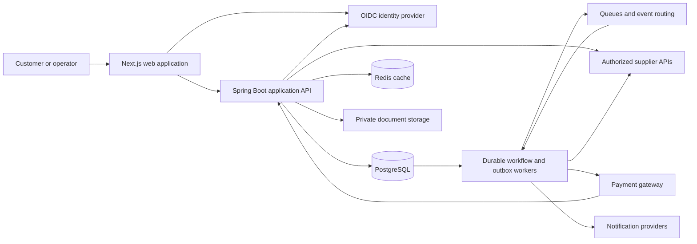
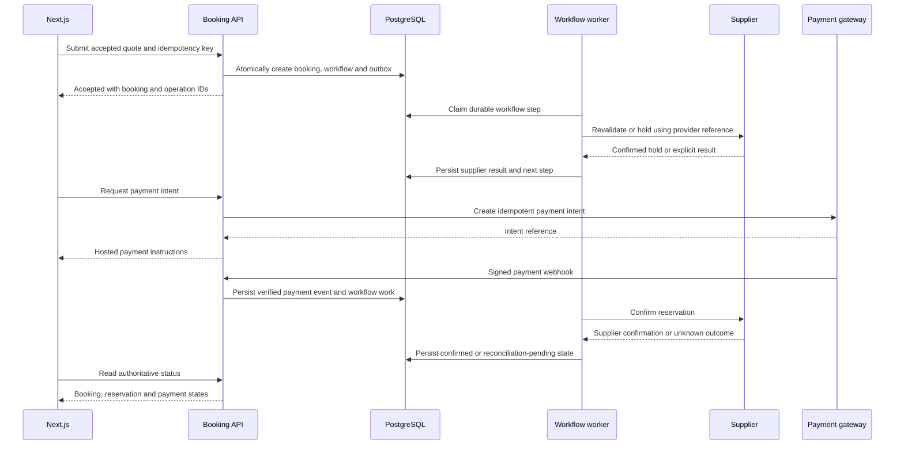

## 1 Purpose and architectural decision

Build an independent travel booking platform with a Next.js frontend and Java 21 Spring Boot backend using Clean Architecture and Hexagonal Architecture. Start with a modular monolith, PostgreSQL as the transactional system of record, and separately scalable background workers. Preserve module boundaries so selected workloads can become independent services when measured scaling, security, ownership, or failure-isolation needs justify the change.

This baseline derives from the supplied master implementation prompt and accompanies AGENTS.md. No application repository has been assessed, and the components below describe the intended system rather than deployed infrastructure. Exact dependency versions, supplier contracts, region, workload forecasts, and production SLOs require validation during discovery.

The primary design constraint is financial and reservation correctness under unreliable external systems. A payment can succeed while a reservation remains unknown; the platform must preserve that distinction, recover durable work, and reconcile ambiguous outcomes.

## 2 Scope and customer journeys

P0 delivery covers flights, trains, buses, hotels and homestays, holidays, identity/customer profiles, search, authoritative quotations, booking, payments, trips/documents, cancellations, refunds, and necessary operational support. Cabs and other P1/P2 capabilities follow their source priorities. Preserve detailed source priorities when reconciling the requirements register.

The customer lifecycle is discovery → search → comparison → selection → revalidation → quotation → booking/payment → confirmation → trip management → cancellation/refund. The execution order varies by supplier: hold/pay/confirm, pay/reserve/confirm, reservation with deferred payment, or enquiry and quotation followed by fulfilment.

Use independent branding and licensed content. Supplier access is an external dependency, not an assumed capability. A blocked live provider does not prevent deterministic local development, but it does prevent claiming a live journey is complete.

## 3 System context and deployment units



| Deployment unit | Responsibility | Scaling boundary |
| --- | --- | --- |
| Next.js web | Rendering, navigation, forms, authenticated UI, typed API integration | Web traffic and rendering load |
| Spring Boot API | Authentication enforcement, queries, validated commands, durable acceptance, webhooks | Request latency and throughput |
| Workflow workers | Provider mutations, retries, reconciliation, documents, notifications | Queue depth, oldest work age, provider limits |
| PostgreSQL | Owned business state, workflow records, financial records, idempotency, outbox | Transaction contention, query load, storage |
| Redis | Search caching and suitable ephemeral coordination | Cache hit rate, memory, request volume |

API and worker processes may use the same codebase with separate runtime profiles. A database-backed worker is sufficient initially; introduce queue delivery where it improves workload isolation. The database remains authoritative even when queues trigger processing.

## 4 Frontend architecture

Use Next.js, React and TypeScript with shared design tokens, accessible components, feature modules, typed API clients, and query/mutation hooks. Prefer server rendering for public discovery and appropriate initial data; isolate interactive forms, seat maps, and checkout state in client components. Keep supplier secrets and privileged tokens on server boundaries.

The integration path is route → feature component → query/mutation hook → generated TypeScript client → backend API. A Next.js BFF may manage secure sessions or aggregate presentation data, but must not duplicate pricing, reservation, authorization, or refund rules.

Search parameters belong in shareable URL state where practical. Sensitive traveller data must not enter URLs, analytics, or persistent browser storage without a justified requirement. Restore checkout by authenticated booking/operation identifiers after refresh.

Use an OIDC authorization-code flow and secure session handling. If browser requests use cookies, implement CSRF controls, secure HttpOnly cookies, suitable SameSite policy, and explicit origin rules. Select the precise identity/session topology in an ADR before implementation.

All journeys support loading, empty, partial, stale, validation, failure, and pending states. Price changes require customer acceptance. The UI displays separate booking, supplier, payment, and refund states and never infers confirmation from a payment return page. Polling uses backoff, visibility-aware limits, terminal-state detection, and a bounded interval budget.

Target WCAG 2.2 AA with keyboard access, focus management, semantic controls, labels, contrast, reduced motion, and responsive layouts. Search and checkout must remain usable on mobile and with assistive technology.

## 5 Backend boundaries

Organize by business context, then architectural layer:

```text
<context>/domain/model
<context>/domain/event
<context>/domain/service
<context>/application/port/in
<context>/application/port/out
<context>/application/usecase
<context>/adapter/in/web
<context>/adapter/in/messaging
<context>/adapter/out/persistence
<context>/adapter/out/supplier
<context>/config
```

The domain contains aggregate invariants, value objects, business policies, and legal state transitions. It has no Spring, JPA, AWS, messaging SDK, HTTP client, or supplier DTO dependencies. Application use cases coordinate core-owned ports and local transaction boundaries. Outbound adapters implement these ports; configuration composes implementations.

Controllers validate transport input, resolve principals, invoke inbound ports, and translate responses. Persistence models and provider payloads are mapped at adapter boundaries. Controllers do not access repositories directly, and modules do not read another module's tables to bypass its public interface. ArchUnit checks enforce these rules and reject dependency cycles.

| Context | Ownership and published capabilities |
| --- | --- |
| Identity and customer | Profiles, saved travellers, ownership and role policies |
| Catalog and location | Canonical cities, airports, stations, properties, supplier mappings |
| Supplier connectivity | Capability registry, provider translation, limits and credentials integration |
| Search | Fan-out, normalization, filtering, sorting, freshness and partial results |
| Pricing and offers | Taxes, fees, discounts, coupon eligibility, immutable quote snapshots |
| Booking | Booking/items, reservation orchestration, holds, transitions and compensation |
| Payments | Payment intents, authorization/capture, gateway state and refund execution |
| Financial reconciliation | Immutable financial records, settlements and discrepancy cases |
| Trips and documents | Customer trip views, tickets, vouchers, invoices and protected delivery |
| Notifications | Templates, delivery attempts and preferences |
| Holidays | Package composition, enquiry, itinerary and component fulfilment |
| Operations and analytics | Audited support actions, reporting and privacy-aware events |

Use public application interfaces for synchronous collaboration and versioned events for asynchronous propagation. Extract services only with an ADR addressing ownership, consistency, deployment, migration, and operational cost.

## 6 Contracts and traceability

OpenAPI is the HTTP contract source of truth. Define contracts before endpoint implementation and generate the frontend client reproducibly. CI checks schema validity, client drift, and compatibility. Define event schemas alongside HTTP contracts.

Every operation specifies authentication/ownership, schema, constraints, errors, status codes, pagination, idempotency, freshness, monetary representation and timezone semantics. Return stable machine-readable errors using application/problem+json and a correlation identifier. A 202 response means durable acceptance and returns an operation/status resource; it does not mean fulfilment.

| Capability | Proposed contract family | Primary owner |
| --- | --- | --- |
| Locations | GET /api/v1/locations | Catalog |
| Search | POST /api/v1/{vertical}/search | Search |
| Reprice | POST /api/v1/{vertical}/offers/{id}/reprice | Pricing with supplier ports |
| Quote | POST /api/v1/quotes | Pricing |
| Booking | POST /api/v1/bookings and GET /api/v1/bookings/{id} | Booking |
| Payment | POST /api/v1/bookings/{id}/payment-intents | Payments |
| Webhooks | POST /api/v1/webhooks/payments/{provider} | Payments |
| Trips | GET /api/v1/me/bookings | Trips |
| Cancellation | POST /api/v1/bookings/{id}/cancellation-quotes and /cancellations | Booking |
| Refunds and documents | GET /api/v1/bookings/{id}/refunds and /documents | Payments and trips |

Paths are design proposals; vertical details require individual schemas rather than an overly generic travel product model.

The RTM preserves original frontend/backend IDs and priorities and links each business outcome to acceptance criteria, screen/component/hook, contract, use case, aggregate, ports, adapter, tables/migrations, events, security, failure handling and executed tests. New integration IDs must be distinguishable from original source IDs. Missing specifications remain recorded gaps.

Example: safe bus-seat booking maps to the seat-map component, availability/hold contracts, seat reservation use case, supplier reservation port, provider adapter, quote and booking records, inventory-expiry events, contention tests, and an integrated checkout scenario. An endpoint returning 200 is insufficient evidence of that outcome.

## 7 Persistence and consistency

PostgreSQL stores customers, supplier mappings, quotes/items, bookings/items/travellers, reservations, workflow steps, payment intents/transactions, refunds, financial entries, coupon redemptions, idempotency records, outbox/inbox entries, documents, audits and reconciliation cases. Modules own their schemas or table groups.

Use primary/foreign keys within ownership boundaries, uniqueness constraints, optimistic versions, and narrowly scoped locking when required. Persist business state and its outbox messages in the same transaction. External calls occur outside local database transactions.

Represent money with BigDecimal and ISO currency plus explicit rounding rules. API schemas use decimal strings or defined minor-unit integers rather than binary floating point. Quotes retain immutable line items, taxes, fees, supplier offer references, expiry, version and cancellation-policy snapshots. Record instants consistently while retaining travel-local zones and dates.

Flyway migrations use expand/migrate/contract for compatibility. Test migrations against representative data and preserve financial/audit history. Financial corrections use linked immutable adjustments; use double-entry accounting when platform responsibilities require it.

Redis can cache searches and reference data with freshness metadata. It cannot authorize final inventory, payments, booking transitions, or durable idempotency. Cache keys must isolate provider mode and applicable pricing context. Never place unrestricted PII in shared caches.

## 8 Booking workflow and failure recovery

Model booking, supplier reservation per item, payment, refund and workflow execution independently. Booking confirmation requires required supplier fulfilment plus the applicable payment policy. Supplier-supported deferred-payment bookings need an explicit policy rather than a universal paid flag.



This sequence illustrates hold/pay/confirm. Provider strategies may reorder steps without weakening durable state, idempotency or reconciliation.

Idempotency records include principal/operation scope, key, canonical request fingerprint, operation ID, processing state and response reference. Claim keys atomically under a uniqueness constraint. Equivalent retries return the original operation; changed payloads conflict. Retention must cover realistic retry and reconciliation windows.

Workers use durable claims with expiry and version/fencing checks to prevent stale workers committing transitions. Persist attempt metadata and provider references before or alongside safe execution. Where a provider lacks idempotency and an outcome is uncertain, query status or open reconciliation rather than blindly repeating the mutation.

| Failure | Required behavior |
| --- | --- |
| Quote expired or price changed | Reprice; obtain explicit acceptance before commitment |
| Seat or room lost | Return a business conflict; release applicable holds |
| Payment succeeds and reservation fails | Record failed fulfilment; initiate policy-approved void/refund compensation |
| Reservation call times out | Mark unknown; query provider and reconcile before retry |
| Supplier confirms after timeout | Apply a guarded transition; reconcile any concurrent compensation |
| Duplicate or out-of-order callback | Deduplicate durably and enforce legal transitions |
| Worker crashes | Resume persisted step with provider-status checks |
| Cancellation succeeds and refund is delayed | Show cancelled booking and independently pending refund |
| Package partially fulfilled | Track each component and execute the documented compensation policy |

No final success is fabricated to close an unresolved workflow. Reconciliation cases include ownership, next action, attempt schedule, age, and escalation threshold.

## 9 Payments and events

Use authorized hosted/tokenized gateway flows. Never collect or log raw card credentials unnecessarily. Verify webhook signatures using the provider's exact payload protocol, freshness, identifiers, expected amounts/currencies, and replay protections. Acknowledge only after durable acceptance according to provider requirements.

Keep authorization, capture, void, full/partial refund and settlement states distinct. Constrain concurrent refunds so the refundable captured balance cannot be exceeded. Reconcile local financial entries against gateway and supplier records, with audited permissions for manual adjustments.

Outbox dispatch is at least once. Event envelopes carry event ID, type/schema version, aggregate ID/version, timestamp, correlation and causation IDs, producer and payload. Consumers use a durable inbox or equivalent deduplication and atomic effect application, ordering guards, bounded retry, DLQ and controlled replay. Broker delivery guarantees do not establish end-to-end exactly-once financial effects.

## 10 Supplier integration modes

Each adapter declares MOCK, SANDBOX or LIVE through explicit configuration. Local/test environments default to deterministic MOCK. Credential presence never activates LIVE, and configuration errors fail closed rather than silently substituting fake results.

Mock reservations and documents remain unmistakably simulated. Sandbox operation uses authorized test endpoints; live operation requires provider onboarding, approved configuration and operational release gates. Isolate mode in data, cache keys, event metadata and observability to avoid cross-mode fulfilment.

The capability matrix records search/reprice/hold/book/ticket/status/cancel/refund support, rate limits, timeouts, idempotency, authentication, error mapping, mode and contract tests. Bound search fan-out and return explicit partial-result metadata. Railway restrictions, waitlist/RAC behavior, berth allocation, hotel occupancy, bus seats and holiday enquiry flows remain provider-specific policies.

## 11 AWS target architecture and security

Proposed production topology uses Route 53 and CloudFront for public entry, WAF protection, and an ALB to containerized web/API workloads on ECS Fargate. Place backend workers and data services in private subnets across availability zones. Use RDS/Aurora PostgreSQL, suitable ElastiCache, SQS/EventBridge when needed, private S3 documents, Secrets Manager, KMS and centralized logs/traces/metrics. EKS and Kafka are not initial requirements.

Validate the AWS region against data residency, supplier connectivity, service availability and latency. Use separate environment accounts and IAM roles. Restrict outbound connectivity, inbound database access and document retrieval; issue short-lived authorized download links. Production sizing and disaster recovery topology follow measured demand and approved objectives.

Enforce resource-level ownership for bookings, travellers, payments and documents; role controls and MFA protect privileged operations. Apply request limits, injection protections, secure headers/session policies, TLS, encryption, redaction, retention and deletion controls. Threat modelling must include account takeover, IDOR, webhook forgery/replay, coupon abuse, duplicate financial effects and supplier credential exposure.

| AWS pillar | Design and acceptance evidence |
| --- | --- |
| Operational Excellence | Terraform, reproducible CI/CD, dashboards, actionable alerts, runbooks and tested deployment rollback |
| Security | Least privilege, environment isolation, encryption, secret rotation, audit and security testing |
| Reliability | Multi-AZ components, durable workflows, idempotent processing, reconciliation and successful restore/DR drills |
| Performance Efficiency | Bounded fan-out, caching, query/index profiling, load tests and measured autoscaling |
| Cost Optimization | Budgets/tags, right-sizing, retention, provider-call budgets and cost per search/confirmed booking |
| Sustainability | Reduced redundant work, efficient utilization, data lifecycle and cleanup with measured improvements |

## 12 Operations and measurable targets

Proposed targets from the master prompt are 99.95% monthly availability for owned critical booking APIs, 99.9% search availability, p95 aggregated search within 3 seconds, p95 durable booking-command acceptance within 500 ms, RTO within 60 minutes and RPO within 5 minutes. These are targets, not achieved benchmarks. Define denominators, measurement windows, exclusions and error budgets before release.

Illustrative 500 search requests/s, 50 booking commands/s and 5× bursts require validation against traffic estimates and supplier quotas. Separate owned latency from supplier latency. Track queue age, pending/unknown bookings, idempotency conflicts, callback errors, reconciliation age, refund backlog, provider health, conversion and infrastructure/provider costs.

Backups alone do not prove recovery. Test restoration, replay behavior and recovery of external transactions around the restore point. Use provider reconciliation to identify remote effects absent from restored local records. Validate whether regional recovery is necessary to achieve the chosen objectives.

## 13 Testing and release process

CI runs formatting/type/build checks, Java unit and architecture tests, Testcontainers database/migration tests, API/provider contract tests and frontend component tests. Integrated Playwright journeys exercise the actual frontend/backend with deterministic providers; authorized sandbox suites add external-contract evidence.

Correctness tests cover concurrency, duplicate keys with changed bodies, quote expiry, price changes, exhausted inventory, duplicate/out-of-order webhooks, unknown outcomes, payment-without-reservation, partial refunds, cancellation, process restart, event replay, unauthorized object access and partial supplier outage. Assert persisted transitions and external effect counts. Include mobile, keyboard and accessibility checks.

Stage release through deterministic integration, sandbox verification, hardening and controlled rollout. Use backward-compatible migrations and application rollback plans. Gate live enablement on access, security, reconciliation, recovery and operational evidence. Report failed/skipped checks and distinguish mock verification from real provider verification.

## 14 Phased delivery

| Phase | Deliverable and exit gate |
| --- | --- |
| 0 | Repository/source discovery, requirements register/RTM, supplier matrix and architecture ADRs |
| 1 | Integrated Next.js/Spring foundation, auth, migrations, OpenAPI/client, mocks, CI and architecture checks |
| 2 | Catalog and category search with partial/failure behavior |
| 3 | Details, policies, revalidation and authoritative quotes |
| 4 | Durable booking checkout with contention, idempotency and compensation tests |
| 5 | First full vertical selected by sandbox access; payment through confirmation/trips/documents |
| 6 | Remaining P0 verticals with provider-specific verification and explicit access blockers |
| 7 | Cancellation/refunds, reconciliation, notifications and operations |
| 8 | Security/load/failure/restore evidence and six-pillar release assessment |
| 9 | Prioritized cabs, planning, personalization and other enhancements |

Each slice updates its contracts, RTM, tests, migration/configuration instructions and operational documentation. P0 completion requires cross-layer acceptance evidence; a documented supplier blocker remains incomplete scope.

## 15 Decisions and outstanding discovery

Adopt the modular monolith, core-owned ports, API-first contracts, PostgreSQL authority, durable workflow/outbox, independent financial states and explicit integration modes as baseline decisions. Record implementation-specific alternatives and trade-offs as ADRs.

Resolve during discovery: exact source requirement mappings; supplier/gateway onboarding and capabilities; identity/session provider; runtime versions; regional/data obligations; payment and settlement responsibilities; initial vertical; traffic and retention forecasts; disaster-recovery scope; and operational ownership. These decisions determine implementation details without changing the core correctness boundaries.

Handoffs report delivered requirement IDs, changed artifacts, verified paths and modes, exact executed checks, unresolved failures/blockers, and next migration/configuration/operational actions. Production readiness requires evidence from the implemented system.
