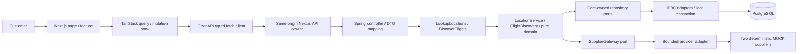
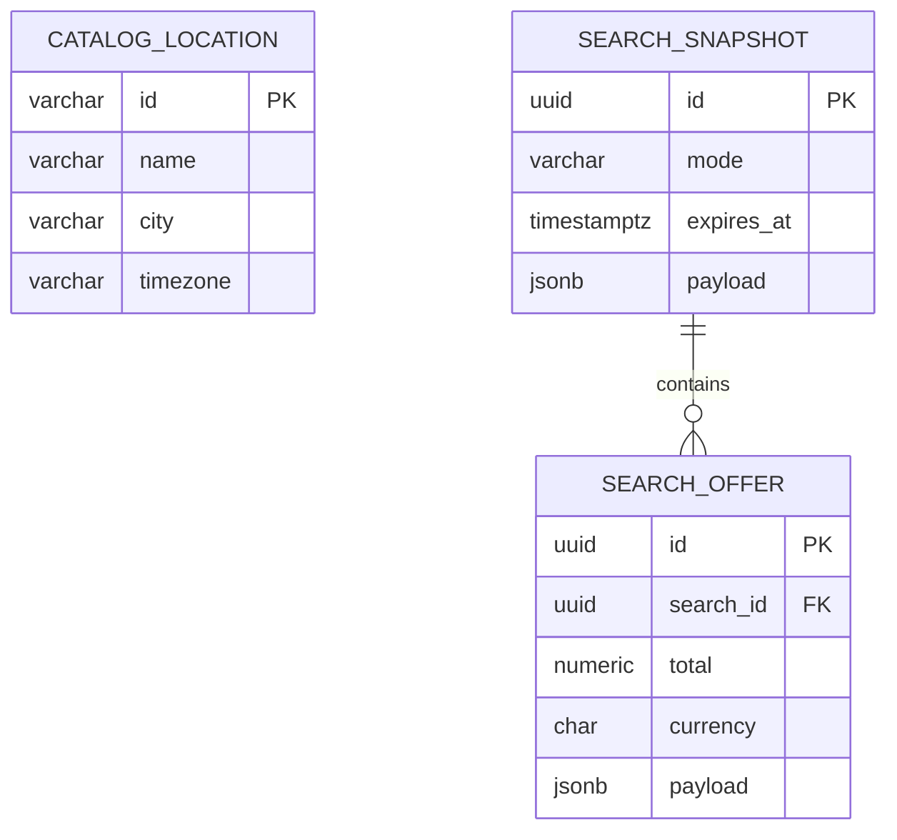

# ADR 0001 — Modular discovery foundation

Status: accepted for the implemented local increment, 2026-10-31.

The five source documents describe a much larger platform than the initially empty workspace. Start with one Next.js app and one Java 21/Spring Boot 4.0.9 deployable; catalog and search contexts are separate packages, each with core-owned ports, pure domain models, use cases, inbound web adapters, outbound persistence/provider adapters and composition. ArchUnit enforces direction, controller isolation, catalog encapsulation and context acyclicity.

Use Spring JDBC rather than JPA for three simple read/snapshot tables. Records in the domain are not persistence entities or public HTTP types. Web adapters map to explicit response views; money is a decimal string. Spring Boot's BOM owns framework, Flyway, database-driver and Testcontainers versions. Frontend direct packages and transitive dependencies are pinned by the lockfile. Installed dependency versions were resolved against their registries; npm audit is part of the check set.

The first slice is flight discovery because it validates contracts, date/passenger rules, provider degradation, decimal prices and frontend state without financial side effects. No authorized sandbox was supplied. This decision does not select the first *bookable* vertical: bus or hotel should still be selected based on actual authorized sandbox quality, or explicitly completed in MOCK.

Public search is anonymous. No custom insecure demo-login token is introduced. A configured OIDC issuer enables standard signature/issuer/expiry/audience validation, but private routes remain denied and interactive sign-in is unfinished. No ownership claims are made for unimplemented customer/booking features. Search IDs hold no personal data and are not security credentials for future customer resources.

Persist each search and its offers atomically after provider calls complete. A search expires after 15 minutes. Filters/paging operate on the same snapshot with ID tie-breaking, so supplier refresh cannot create duplicate page entries. Reprice calls the originating provider and returns a separate two-minute observation; it never rewrites the snapshot or reserves inventory. Quotes, outbox and workflow tables will be introduced with their actual use cases, not unused placeholders.

Use a fixed pool of eight supplier tasks and a queue of sixteen, a common 1.5-second deadline, cancellation on timeout and no automatic supplier retries. Both configured providers are MOCK. Exhausted capacity and provider errors are explicit coverage failures; all-failed search returns 503. No inventory-identity deduplication is attempted between distinct simulated airlines. Per-provider commercial quotas, circuit breakers and load-based sizing remain later requirements.

No Redis, broker, microservices, virtual-thread enablement or AWS resources are necessary for this read/discovery slice. PostgreSQL remains the future transactional authority. Durable database workflows/outbox precede SQS introduction. The broader [architecture baseline](../../ARCHITECTURE.MD) remains a target, with implemented subset shown below.

The Next.js rewrite owns routing only; authoritative validation, money and availability remain in Java. Public landing content uses server rendering; the interactive query form is client-side under Suspense. Browser search IDs and filters are URL state; no traveller or account data is stored in browser storage.

Branding uses original CSS scenery and Lucide icons (ISC licensed dependency). Public MakeMyTrip flights navigation and explanatory content were inspected read-only for functional context; no supplier integration rights or access were inferred. No proprietary assets or implementation were copied.

Consequences: this is a small integrated increment, not a complete Phase 1 or Phase 2. No account/customer, booking/payment, protected documents or provider commerce exists yet. All remain in the RTM.
