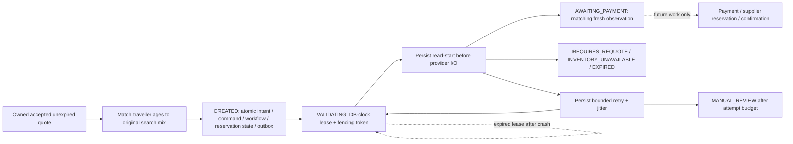

# ADR 0003 — Durable booking intent and validation recovery

Accepted for this slice. One accepted quote can create at most one owned booking intent. Different command keys with the same normalized traveller payload recover that intent; changed payloads conflict. Equivalent same-key replays return the original immutable acknowledgement even after expiry. New intent acceptance checks the quote's owner, accepted version, expiry and original adult/child/infant mix. Names/DOB are private data, never URL/browser-storage state.

Booking owns immutable quote/itinerary/traveller input plus versioned mutable status. The original category mix is read through a published search contract and copied into the booking snapshot; existing immutable quotes are not rewritten. Pricing/customer/search private tables remain inaccessible to the booking application. Provider reference reads for an already accepted quote do not treat discovery-cache expiry as supplier unavailability; departure and quote expiry are still enforced.

The first durable workflow step is VALIDATE_OFFER. PostgreSQL claims use SKIP LOCKED, database-clock leases and fresh fencing tokens. A persisted read-start marker and attempt counter precede each bounded provider read. No database transaction spans provider I/O. Expired leases are recoverable after process loss; stale workers cannot commit. Reads may retry with bounded backoff; after four possible provider attempts, unresolved work enters manual review. Quote expiry is checked before submission, before reads and again before a successful completion commits.

Terminal validation outcomes distinguish awaiting payment, changed price/policies (requires new quote), unavailable inventory, expired quote and unresolved provider outage. AWAITING_PAYMENT is not reservation/booking confirmation. Persist reservation NOT_REQUESTED and inventory-check state separately. Payment remains a declared NOT_STARTED capability state; no payment aggregate, charge, hold, reserve or ticket operation is introduced.

Each booking state transition commits its versioned outbox event with local state. The workflow can resume directly from PostgreSQL; neither Redis nor a broker is required to recover. Event publication/consumption remains separate pending work. A stable request fingerprint prevents replay from altering traveller data; booking input, command and event history are immutable at the database boundary.

The MOCK age policy is adult 12+, child 2–11, infant under 2 on every journey departure, maximum age 120, one infant per adult and at most nine seated travellers. Reject category changes across return travel and duplicate normalized traveller entries. Real provider policies must replace/extend these explicit fixture rules before live enablement.

Verification will include real HTTP/DB ownership and concurrency tests, stale-lease fencing, retry exhaustion, quote expiry and price/policy changes, an actual child-JVM crash/restart with the same PostgreSQL state, plus browser submission/recovery/status/My Trips checks. Crash tests simulate elapsed downtime by expiring the abandoned lease; they do not claim a production DR drill.

V4 introduces booking persistence; V5 persists definition version 1, which this worker explicitly selects. Application/API and identity requests have independent bounded process budgets so API bursts cannot consume login capacity. Both still need production per-client/distributed enforcement.

The success edge ends this validation step only. Reservation remains NOT_REQUESTED and payment remains NOT_STARTED; the future block is not implemented.
