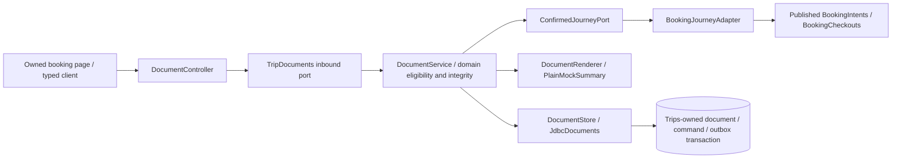

# ADR 0006 — Generator security repair and protected MOCK summaries

Pin actual minimatch 11.0.1 under the existing generator's Redocly 1.34.22 dependency. The [upstream advisory](https://github.com/advisories/GHSA-g3hv-75wg-m249) lists this patched release. Redocly 1.x expects a callable CommonJS export; adapt its one consumer to the named function through a reproducible postinstall patch. Verify the upstream source hash and dependency versions before patching; fail closed on unexpected changes. No package version spoofing, audit suppression, force downgrade or unreviewed replacement framework. Remove the override/patch when a compatible upstream generator release resolves the dependency chain. A clean install, byte-identical generated client and matching/nullable/ref regression tests are acceptance gates.

An isolated Redocly 2.72.1 override was evaluated and rejected: openapi-typescript imports internal ref-utils paths which that version does not export. It was not applied to the project. The committed fix changes only the dependency chain and its one export adaptation.

Add a Trips context for owned immutable UTF-8 MOCK confirmation summaries. They explicitly state NOT A TICKET OR TAX INVOICE. Do not fabricate a PNR or imply real provider access. Generation requires an owned CONFIRMED checkout, CAPTURED payment, CONFIRMED supplier and matching MOCK references. Read canonical booking data through published ports, not cross-context tables. Document bodies contain names/itinerary/pricing/policies but omit dates of birth, tokens and owner identity. Contents never enter lifecycle event payloads.

Explicit generation POST is synchronous and idempotent; reads do not create records. One fixed document kind/version per booking. Persist the exact bytes/hash, owner, source checkout/version, command and outbox atomically. PostgreSQL is adequate for these bounded 32KiB text fixtures; introduce an object-storage adapter for real larger/provider documents when justified. No PDF library, S3 deployment or signed public URL is needed for this slice. Every list/download rechecks ownership and confirmation eligibility; responses are no-store, nosniff attachments with server-generated filenames.

This closes a working MOCK download path, not the full P0 ticket/voucher/invoice requirement. Refunds, real provider documents, retention/deletion policy, checkout/document event dispatch and AWS remain outstanding. Source requirements remain In progress where broader functionality is absent.

