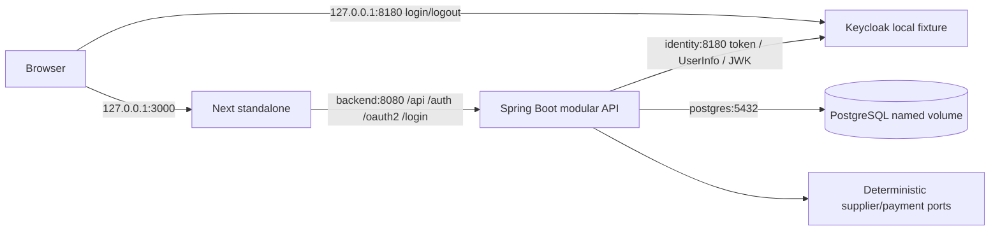

# ADR 0008 — Build and run the application in local Compose

Status: accepted, 2026-10-31. Scope: local MOCK integration deployment; no AWS or production enablement.

## Context and decision

Compose previously ran only PostgreSQL and local Keycloak. Add the modular Java API and Next.js production server as built images. Keep one database authority, its existing `travbook-data` volume and migrations V1–V9. No broker, cache, migration rewrite or new deployable business service is introduced.

Multi-stage builds use digest-pinned official Maven/Temurin Java 21 and Node 24 images. The frontend installs from the workspace lockfile, including the guarded Redocly adaptation, and produces Next standalone output with the repository as its tracing root. Both runtime users are non-root; application roots are read-only with bounded temporary storage, memory/PID limits, dropped capabilities, no-new-privileges and rotating logs. These are local bounds, not measured capacity recommendations.

Next rewrites bake `API_URL` into the image. Compose builds with `http://backend:8080`; changing this destination requires a rebuild. It is a non-secret server proxy address, never a browser API base or credential. Only traced runtime files/static assets and the packaged API JAR reach the final images. Credentials, local environment files, host dependencies and build output are excluded from the build context.

## Authentication across the container boundary

The public issuer remains `http://127.0.0.1:8180/realms/travbook`, preserving customer issuer/subject ownership. The browser origin remains `http://127.0.0.1:3000`. A dedicated `compose-local` profile explicitly builds the local client registration: authorization/logout/redirect URLs stay public; token, UserInfo and JWK calls use `identity:8180` on the Compose network. This avoids trying to discover the browser's loopback endpoint from inside the API container.

Issuer, signature, expiry, subject and audience validation remain enabled. Login retains state, nonce, PKCE, JDBC sessions and CSRF. The profile rejects changed issuer/origin, non-MOCK mode, disabled login/local identity, and mixed native/external OIDC profiles. The native profile still requires a loopback bind; external identity still requires HTTPS and Secure cookies. The Compose application binds all interfaces **inside** the container and relies on fixed `127.0.0.1` host publications; Java cannot inspect the host port mapping. CI/recovery verification checks those mappings. Never expose this fixture topology on a remote interface.

Sign-in now redirects to the validated browser origin rather than letting the servlet convert a relative redirect to the internal backend hostname. Client-controlled forwarded headers do not choose that origin.

## Readiness, recovery and limits

Compose gates API startup on healthy PostgreSQL/identity and frontend startup on healthy API. API health includes the database. Frontend health makes a read-only catalog request through its production proxy, proving the route without creating anonymous sessions. Health status does not automatically restart an unhealthy-but-running container; operators must diagnose it. Process exits use `unless-stopped`; graceful stop gives the API 45 seconds while durable workers retain PostgreSQL claims and receipts.

The runbook and AC-036/037 cover builds, actual OIDC browser journeys, service restart with retained session/booking/idempotency, effect counts and balanced journal entries. The restart is not a database restore, disaster recovery drill, zero-downtime rollout, load benchmark or proof of production readiness. CI contains a separate Compose job; local execution does not establish hosted CI success.

Public fixture passwords, HTTP, Keycloak `start-dev`, a privileged development database user, no production secret store and no managed backup remain deliberate local-only limitations. Real providers/documents, legacy policy review, operational resolution, remaining verticals and AWS remain tracked separately.

Implementation references: [Compose](../../compose.yaml), [API Dockerfile](../../apps/api/Dockerfile), [web Dockerfile](../../apps/web/Dockerfile), [identity configuration](../../apps/api/src/main/java/com/travbook/platform/security/LocalComposeIdentityConfiguration.java), [runbook](../runbooks/local-compose.md).

Technical references: [Next standalone output](https://nextjs.org/docs/app/api-reference/config/next-config-js/output), [Spring client configuration](https://docs.spring.io/spring-security/reference/7.0/reactive/oauth2/login/core.html), [Compose service/readiness semantics](https://docs.docker.com/reference/compose-file/services/).
