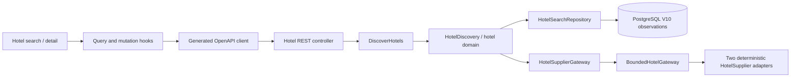

# ADR 0009 — Hotel discovery and multi-room rate selection

Accepted, 2026-10-31. First hotel increment: search → filter → property detail → compare/select rooms → revalidate the whole selection. Deterministic MOCK only; no hotel booking, charge, guest collection or voucher operation is enabled.

## Context and boundaries

Existing pricing/booking records are explicitly flight-specific: itinerary legs, departures, passenger categories, airline policies and confirmation summaries. Reusing them for stays would misrepresent occupancy, room stock, nightly charges and cancellation cutoffs. This increment introduces one logical `hotels` context inside the existing modular API, not another service. Domain records enforce date/occupancy/money invariants; `DiscoverHotels` exposes application operations; supplier and persistence ports are owned by the application; JDBC/MOCK/bounded-concurrency adapters implement those ports. Controllers only validate/map transport and invoke the inbound port. Architecture tests forbid hotel observations depending on flight/financial contexts.

## Domain and supplier decisions

- Stays are 1–30 nights, check-in today or later, check-out at most 330 days ahead. All current fixtures use Asia/Kolkata; dates remain local dates, observation/cancellation deadlines are instants, and property check-in/out times remain explicit.
- 1–4 room occupancies, each with 1–3 adults aged 18+ and 0–2 children with individual ages 0–17 at check-in. Infants remain part of room capacity even when their fixture supplement is zero. Do not apply the flight adult threshold of 12.
- Each room offer binds one room index, occupancy, property and provider. Exactly one offer per requested room, in order, is required for revalidation. Reject repeated IDs, mixed snapshots, mixed properties/providers and mismatched indices. Rate plans sharing a room type share inventory; different plan codes do not create new physical rooms.
- Supplier rates contain nightly amounts, total base, simulated tax, per-room service fee, exact inclusions and refund cutoff. Use BigDecimal; transport money is decimal strings. The browser formats server prices and does not calculate an authoritative selection total.
- FLEX includes breakfast and an explicit 48-hour-before-local-check-in cutoff; VALUE is non-refundable and room-only. FAMILY demonstrates a current-rate increase. STUDIO demonstrates lost inventory. These are deterministic fixtures, not claims about real scarcity or hotel policy. All taxes/fees/ratings are synthetic. No reviews are invented: review count is zero and the rating source is labelled synthetic.
- Two eligible providers use four worker threads and an eight-task queue, a 1.5-second total search budget and a bounded batch reprice call. No automatic retries or effects. Partial unavailable coverage remains visible; all providers failing returns 503, while successful zero availability returns an empty 200 page. Distinct fixture properties are not deduplicated without an established canonical supplier mapping.

## Persistence and contracts

Additive V10 owns `hotel_search` and `hotel_offer_index`; no existing migration or financial table changes. Snapshot plus offer indexes commit atomically. Search observations expire after at most 15 minutes and never cross the end of the local check-in date. Per-property all-room minimum totals are computed by the application; filters/pagination operate on the saved snapshot. Revalidation reads the selected provider again, caps freshness to five minutes and the original search expiry, and leaves the original observation intact.

Public endpoints are described in OpenAPI 0.8.0. `GET /api/v1/hotel-searches/{id}` avoids ambiguity with `GET /api/v1/hotels/{id}/rooms`. Hotel search/detail/reprice paths are anonymous read-only capabilities, with rate/body limits and no CSRF requirement for observation-only POSTs. They cannot enter the owned flight quote/booking APIs. No hotel mutation, entitlement or confirmation is inferred from a successful reprice response.

Repricing is an observation, not an immutable owned quotation or inventory hold. Changed prices/policies require explicit UI acknowledgement before displaying the reviewed state; the UI clearly states that this acknowledgement is not a saved quote acceptance. Selecting another room removes the prior check/acknowledgement; stale/error observations never display an authoritative current total. Search/filter and room selection IDs survive refresh/back via URL parameters; no names or guest documents are collected.

## Delivery limits and next gate

This implements the first hotel portions of FE-HT-01–03/05–08/11–14/17, BE-HTL-001–011, and FE-AC-06. Source priorities remain intact. Search is sample lexical lookup, not a licensed global hotel catalog. Popularity/recommendation sorting is not shown without evidence. Maps, licensed reviews, whole-property rentals, live providers and all reservation/post-booking capabilities remain pending.

FE-HT-16 is P1 but BE-HTL-012 is P0. Preserve both: backend supplier-aware payment capability remains P0; a pay-at-property UI is exposed only when a verified provider supports it. No pay-at-property option is fabricated in this slice.

Next gate: owned immutable hotel quotations and explicit acceptance, guest eligibility and supported requests, then durable supplier-aware reservation/payment workflow and protected accommodation vouchers. Revalidate before commitment, reserve stock safely across room types/night ranges, and preserve independent payment/reservation outcomes. Operator review, external supplier access, tax/legal policies, physical snapshot retention and production observability/load/DR controls remain unresolved requirements.

See [contract](../../contracts/openapi.json), [traceability](../requirements/rtm.md), [hotel runbook](../runbooks/hotel-discovery.md), and [execution evidence](../verification-hotels.md).
