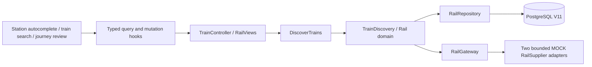

# ADR 0010 — Railway discovery and class/quota observations

Accepted, 2026-10-31. Scope: the first train slice, not authorized ticketing.

## Decision

Introduce one logical `rail` context inside the existing modular Java API. Railway availability, operating days, quotas and passenger/ticket states are not flight itinerary or hotel room concepts. Do not coerce train observations into flight quotations/bookings. The domain holds immutable station, criteria, journey, money, availability and snapshot values. `DiscoverTrains` is the inbound port; `RailRepository`, `RailGateway` and `RailSupplier` own outbound contracts. JDBC and bounded deterministic suppliers are adapters. Architecture tests forbid dependencies on flight/hotel/pricing/booking/payment/trip internals.

V11 adds a small canonical station table, search snapshots and journey indexes. Snapshot/index writes commit atomically; migration preserves V1–V10 data. UUID journey IDs identify observations, not train tickets or PNRs. No reservation stock, ledger entry or workflow is created. Physical observation cleanup is future work, with expiry indexes already present.

## Availability and scope

Keep AVAILABLE, RAC, WAITLIST, UNAVAILABLE and NOT_OPEN distinct. Position means observed count for AVAILABLE and queue position for RAC/WAITLIST, never a prediction or confirmed ticket. No `CONFIRMED` ticket state exists in this context. Class/quota checks fetch the original provider afresh, return old/new status and fares, and cap observation freshness to 60 seconds, original search expiry and departure. Search snapshots expire after 15 minutes; departed journeys and expired searches cannot be rechecked. Repeated reads never overwrite the original observation or create financial effects.

Two providers use two worker threads, a bounded eight-task queue and a shared 1.5-second search budget; fresh availability calls have the same bounded timeout. No automatic retries, fallback to fabricated availability or provider credential collection. Partial failures remain explicit; all providers failing gives 503; successful no service gives empty 200. Status/class filters match the same class entry, not unrelated cells on a train.

All schedules, train names/numbers, operating-day patterns, fares, positions and quota windows are fictional. Identifiers have a `MOCK-` prefix. Base/fee/total are precise INR decimal strings for one demonstration adult; no official tariff, child/concession or passenger/quota eligibility claim is made. The sample search horizon is 60 days, not an official booking horizon. The Tatkal fixture opens at 08:00 IST on the previous day solely to exercise NOT_OPEN/open boundary handling; it is explicitly **not** an official railway rule.

Station codes/names are a small factual catalog, separate from the synthetic services. References checked: [Indian Railways station list](https://indianrailways.gov.in/Railway_station_zone-category_wise_list.pdf) (MMCT) and [major station enquiry index](https://www.indianrail.gov.in/availability_Trains_From_Major_Cities.html) (NDLS, AGC, JP, MAO, HWH). No timetable or reservation APIs were scraped or invoked. Station facts do not establish commercial ticketing rights.

## Integration and UI

OpenAPI 0.9.0 adds station lookup, search, persisted search reads, journey details and fresh class/quota availability. Client generation and compatibility gates retain existing APIs. Public read-only search POST is explicitly CSRF-exempt; no booking POST, PNR lookup or running-status endpoint exists. Body/rate guards, safe problem responses and correlation IDs remain active.

The UI exposes a keyboard station combobox, swap, dates/quotas, class/status filters, class matrix, sample endpoint timeline and a manual fresh-check action. Status text accompanies color. Search/filter and selected class/quota IDs survive refresh. Changing selection clears the prior check; mismatched, failed or expired checks never display an authoritative current fare. There is no automatic availability polling. No passenger/railway credentials or payment data are requested, and no booking-looking CTA is shown.

## Remaining gates

Source requirements stay at their original priorities. This partially covers FE-TR-01–07/15 and BE-RAIL-001–005/013/015. Passenger/quota eligibility, boarding/berth preferences, owned quotation/acceptance, durable reservation/payment, provider authentication handoff, actual PNR/ticket state, cancellations/refunds and exception workflows remain unfinished. Intermediate-stop completeness, alternate journeys, authorized live running status and PNR information remain P1 work. Mock window verification is not delivery of the official Tatkal requirement.

Before ticketing: obtain authorized supplier integration and permitted authentication, define official passenger/quota rules and capabilities, implement durable independent reservation/payment/ticket states, unknown-outcome reconciliation, idempotency and verified documents. Do not enable ticketing merely because search works. See [RTM](../requirements/rtm.md), [runbook](../runbooks/train-discovery.md), and [evidence](../verification-trains.md).
