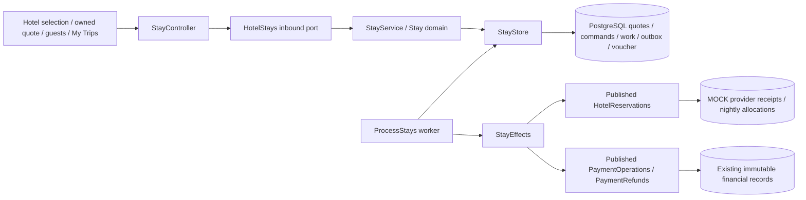
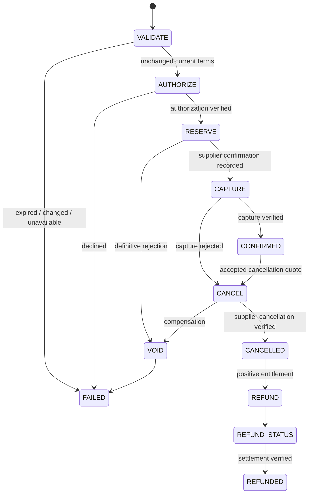

# ADR 0011 — Owned hotel lifecycle with durable MOCK fulfilment

Accepted 2026-10-31. This replaces the earlier hotel delivery limitation for the implemented MOCK lifecycle. Live suppliers/gateways and production document formats remain unavailable.

## Context and chosen boundaries

Flight booking models encode airline legs and passenger categories. Reusing them for hotels would corrupt room/night/age and cancellation semantics. Add a logical `stays` context in the same API deployment. It owns hotel quotations, consent, guest inputs, booking/work state, cancellation quotes, vouchers and lifecycle outbox records. It consumes customer identity and financial capabilities through published application contracts. `hotels` owns discovery and the deterministic supplier reservation/nightly stock adapter. No new deployable service or framework is introduced.

## Quotation, consent and guests

Quote creation performs a fresh whole-selection read before the local transaction. The immutable quote stores property, room/date/occupancy, nightly charges, taxes/fees, meals, precise refund cutoffs, previous/current totals and expiry. Consent binds the exact unexpired version. PostgreSQL command uniqueness is scoped to customer/operation/key with request fingerprints; concurrent equivalent retries return the same resource and changed input conflicts. One booking per quote is enforced by a unique constraint and quote-row lock. Customer ownership is checked for every private operation; session writes retain CSRF and OIDC scopes.

New quote expiry is capped at local property check-in. For historical records, the effective deadline is the earlier of stored expiry/check-in; authorization/reservation and read models use that deadline without rewriting immutable records. A captured or reserved receipt is still reconciled by its original stable operation reference after a response loss.

Guest names are normalized and bounded; dates of birth are validated against check-in. Each quoted room must have the exact adult count (18+) and child-age multiset. Duplicate people and future birth dates fail. Guest input is immutable once accepted. `LATE_ARRIVAL` is recorded as a request, not a guaranteed provider fulfilment. No guest data enters URLs, browser storage, lifecycle events or logs. Quotation and booking resource IDs provide refresh recovery.

OIDC return paths allow only narrowly validated internal stay quote/booking/trip routes. Arbitrary URLs, extra query targets and fragments are rejected; existing flight redirects remain unchanged.

## Durable fulfilment and financial integrity

Booking, supplier reservation, payment, refund and workflow are distinct persisted states. Confirmation requires both supplier confirmation and captured payment. The worker claims one row with SKIP LOCKED and a database-clock 15-second lease/token, then calls providers outside orchestration transactions. Completion is version/fence checked and commits booking, workflow and outbox atomically. A stale worker cannot publish local completion. Stable operation IDs and provider receipt lookup precede effects after crashes/unknown outcomes. The deterministic provider locks operation/property/reservation keys and persists effect receipts atomically with stock. It can return definitive rejection without a financial success claim.

Attempts/backoff are bounded (five for uncertain effects, twenty pending-refund checks, up to eight seconds plus deterministic jitter). Exhaustion becomes REVIEW; no blind second payment or invented success. Process loss after reservation, capture, cancellation and refund commit is tested in real child JVMs. Recovery uses receipts, not a gateway redirect or browser state.

The MOCK hotel provider owns nightly allocations. FLEX/VALUE share two standard rooms; FAMILY/STUDIO have separate fixture pools. Availability reads include committed active allocations. A property lock plus per-night capacity checks serialize overlapping reservation attempts. Cancellation atomically deactivates allocations. These are local provider-simulator semantics, not a substitute for an authorized external supplier's authority. Class/capacity fixture rules remain in the outbound adapter, not generic ports.

Payment adapters reuse published authorize/capture/void and refund interfaces. Amount/currency/mode/resource bindings are checked. Immutable capture and reversing refund entries remain in the existing payments context. No payment tables are read or written from the hotel/stays implementation. Original capture records are never rewritten to represent refunds.

## Aftercare and documents

Cancellation quotes bind booking version and per-room entitlement, expire within five minutes and before the next refund cutoff/check-in. All rooms are cancelled together; mixed refundable/non-refundable rooms produce a partial monetary refund without partial reservation cancellation. A positive refund is submitted only after verified supplier cancellation. Zero entitlement becomes NOT_DUE without a refund transaction. Pending refund commitments count against captured funds, and delayed/lost acknowledgements reconcile safely.

Vouchers are owned immutable UTF-8 MOCK accommodation artifacts, capped at 32KiB with SHA-256 verification. They require currently confirmed reservation/capture, contain names/room terms but no DOB, and explicitly say **NOT VALID FOR CHECK-IN**. Preparation is idempotent; metadata/download are authorized and no-store. Cancellation/review blocks access. This is a functioning local document workflow, not a real provider-issued voucher or tax invoice.

My Trips includes hotel cards with private detail/status, refund state and committed lifecycle history. Polling is bounded to twenty reads per booking/aftercare phase with backoff, stops at terminal/error state and pauses in the background. Browser acknowledgement loss is recovered by quote → existing booking lookup. Provider/refund uncertainty stays visible.

## Persistence, events and deployment

V12 adds the hotel lifecycle/provider tables. V13 adds explicit persisted MOCK mode and owner/resource/state/event guards without rewriting the already-applied V12 migration. Quotes, acceptances, commands, cancellation quotes, vouchers, provider receipts and outbox envelopes are immutable. Booking input is immutable; versions and legal transition state are guarded. Existing flight, railway, hotel discovery and financial records remain intact.

Lifecycle envelopes follow [stays.v1](../../contracts/events/stays.v1.schema.json): event/aggregate/version, schema, producer/mode, UTC timestamp, correlation/causation and state-only payloads. Database guards forbid guest payload fields. The owned activity view reads committed local events. External publication/notifications/consumer delivery are not claimed; future delivery must remain at-least-once safe.

## Residual scope

This verifies full-booking MOCK pay-now fulfilment and aftercare. In-place amendments, partial guest/room cancellations, pay-at-property, provider overbooking updates/reaccommodation, external ticket/voucher formats, notifications, operational REVIEW resolution and live providers remain gated or unfinished at their original priorities. Pending REVIEW cases require audited reconciliation; this increment does not grant arbitrary manual state edits. Production IAM/database roles, encryption/retention, load/SLO/DR evidence and AWS remain release gates.

See [runbook](../runbooks/hotel-lifecycle.md), [verification](../verification-hotel-lifecycle.md), [RTM](../requirements/rtm.md) and [supplier matrix](../suppliers.md).
