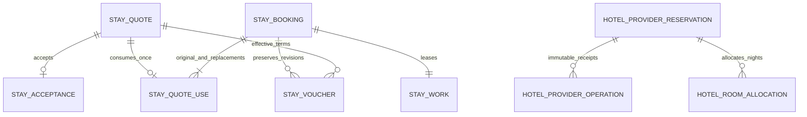

# ADR 0016 — Deferred hotel reservations and date amendments

Status: accepted; scoped implementation verified. MOCK only; no authorized supplier or property collection API exists.

BE-HTL-012 P0 / FE-HT-16 P1: explicit PAY_AT_PROPERTY selection obtains provider-approved FLEX terms. No deposit, penalty collection or platform payment account. Supplier confirmation permits a DEFERRED booking; the outstanding property amount is shown separately. Cancellation before local check-in owes no refund or retained platform funds.

BE-HTL-014 P0 / FE-TRIP-07 P1: implement date changes for deferred stays only, retaining property, room plans and occupancy. The customer obtains and accepts a new immutable quote. A versioned, idempotent amendment consumes that quote once, then a leased worker performs an atomic provider inventory replacement with receipt lookup on recovery. Rejection preserves the previous allocation and terms. Unknown outcomes block cancellation/documents and enter existing REVIEW recovery. Original inputs and every amendment remain recoverable. Dates must not overlap the current stay: this explicit MOCK capability avoids pricing against the booking's own occupied inventory. Prepaid, overlapping-date, room/guest changes and actual provider amendments remain unfinished.

Additive V18, v2 contracts and generated types preserve v1 schemas. V1 rejects deferred/amended resources before side effects. Vouchers are immutable per effective quote; old versions remain stored but current access resolves only the latest confirmed terms. No AWS changes or production enablement.

Acceptance: AC-060 deferred quote → consent → reserve without payment → voucher → zero-refund cancellation; AC-061 replacement quote → durable amendment → receipt recovery → revised dates/document/cancellation; AC-062 ownership, stale versions, quote reuse, inventory rejection, legacy API guards and migration preservation. Executed evidence: [deferred hotel verification](../verification-deferred-hotels.md).

```mermaid
sequenceDiagram
    actor Customer
    participant UI as Next.js / typed v2 client
    participant App as HotelStays / StayService
    participant DB as PostgreSQL / immutable quotes and commands
    participant Worker as Fenced StayWorker
    participant Supplier as MOCK HotelReservations
    Customer->>UI: Accept replacement dates and property amount
    UI->>App: POST amendments (quote, booking version, key, consent)
    App->>DB: Lock work/booking/quote; consume quote; append pending amendment + outbox
    App-->>UI: 202, PROCESSING / DEFERRED / AMEND
    Worker->>DB: Claim leased work
    Worker->>Supplier: Lookup stable amendment operation
    alt No existing receipt
        Worker->>Supplier: Amend with expected old dates/offer IDs
        Supplier->>Supplier: Reprice, then atomically check stock / replace allocation / save receipt
    end
    Supplier-->>Worker: CONFIRMED or REJECTED receipt
    Worker->>DB: Fenced update, close amendment history and append outbox
    UI->>App: Bounded owned status polling
    App-->>UI: Current effective quote; separate reservation/payment states
```

DEFERRED reservation: VALIDATE → RESERVE → DONE. Amendment: CONFIRMED → PROCESSING/AMEND → CONFIRMED (APPLIED or REJECTED); unknown outcomes → REVIEW. Cancellation: CANCELLATION_PENDING → supplier CANCELLED → NOT_DUE/DONE. No AUTHORIZE/CAPTURE/VOID/REFUND step is entered for this strategy.


