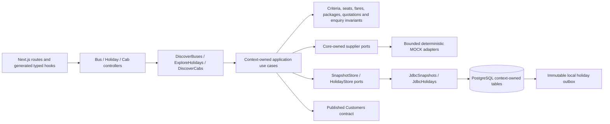

# ADR 0018 — Bus, holiday and cab discovery slices

Status: accepted; scoped MOCK slices verified. No bus/holiday/cab implementation existed at this increment. Keep separate buses, holidays and cabs domain/application/adapter/config packages in the modular backend. Reuse bounded read execution and generic immutable snapshot persistence through core-owned ports, not flight/hotel financial aggregates.

AC-067: route/date bus search → persisted results/filter/sort → simulated seater/sleeper deck layout → ordered seat/age and boarding/drop selection → backend fare check and explicit changed/lost-seat handling. No hold, ticket or reservation is implied.
AC-068: domestic/international package catalogue/filter/detail/itinerary → available departure, party and supported customization → immutable owned quote → idempotent owned enquiry and reloadable local status. Direct booking remains pending; enquiry is recorded locally, not dispatched externally.
AC-069: airport/local/outstation one-way/round-trip search → persisted normalized vehicle results → capacity/luggage filtering → server fare check with explicit kilometre/hour/extras assumptions. No driver allocation or reservation implied.
AC-070: ownership/CSRF, validation/expiry, partial supplier failures versus empty results, schema/client checks, mobile/keyboard/accessibility and migration preservation.

V20 stores context-owned immutable bus/cab snapshots and holiday quotes/enquiries/commands/outbox. Fixed bounded supplier pool and deadline, deterministic MOCK adapters, INR decimal-string amounts, property/journey-local timezone. SANDBOX/LIVE fail closed. No new framework, broker, AWS resource or real provider is introduced.

Preserve BE-BUS-001–016 / FE-BUS-01–14, BE-HOL-001–016 / FE-HOL-01–16 and BE-CAB-001–008 / FE-CAB-01–09 priorities. Detailed mappings distinguish this slice from remaining durable holds/reservations/payments, tickets/vouchers, refunds, tracking, package milestones and component fulfilment.

The existing Docker context already includes application sources/contracts and excludes build output/secrets. Inspect and tighten exclusions for local backups/test artifacts; do not exclude required source assets or tests used in image builds.

No path reaches the existing flight/hotel/rail payment or booking internals. Observations are read capabilities with expiry; holiday enquiry is an owned local-record capability. External provider fulfilment and event delivery are separate unfinished boundaries.

[Verification evidence](../verification-bus-holiday-cab.md): backend, architecture/migration, generated contracts and integrated desktop/mobile gates passed. No booking completion is implied.
