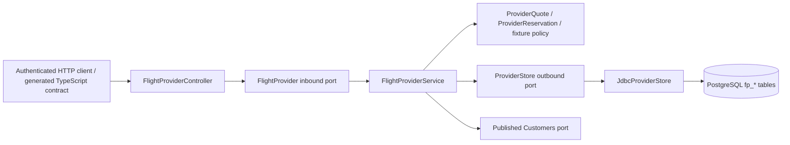

# ADR 0024 — Persistent fictional airline/payment API

Accepted for local MOCK use. Source: user explicitly requested mock APIs after real provider access was identified as absent.

The existing flight discovery and checkout contracts have no ancillary or check-in capability. Add a separate `flightprovider` context inside the modular API, exposed at `/api/v1/demo/flight-provider` under the existing opt-in `DEMO_APIS_ENABLED` flag. No new service, dependency, credential, broker or deployable is justified. Composition rejects every mode except `MOCK`.

The fictional airline is `travbook-fictional-air`; its fictional payment provider is `travbook-fictional-pay`. They have no external authorization, credential store, bank connection or airline affiliation. Existing customer OIDC sessions/scoped bearer tokens protect the test API. The API capability descriptor returns a null provider credential reference rather than inventing a secret ARN or account. Authentication comes from the platform; no shared provider API key is exposed.

The aggregate is a provider test reservation, not an existing platform booking. Its immutable quote snapshots per-passenger base/tax/seat/meal/baggage prices and expiry. Reservation, payment, ticket, refund and passenger check-in are separate states. Real provider payloads do not enter the platform booking domain. This API enables adapter/client development; connecting it to the customer flight checkout is a separate tracked slice, not implied by endpoint availability.

Commands are synchronous local transactions with a three-second database budget. They involve **no remote effects**, so adding a background workflow solely for simulation would add failure modes without benefit. State, immutable command response, money effects, balanced journal and event outbox commit atomically. Process death before commit rolls back; death after commit can be resolved by the original key or owned GET. This is not evidence for unknown-outcome recovery against a real provider. The outbox is persisted; no notification consumer or broker delivery is claimed.

Idempotency is scoped to customer, operation and key, with SHA-256 canonical input fingerprints and database uniqueness. Quote inputs and check-in slot ordering are canonicalized. Advisory transaction locks serialize matching commands; a reservation row lock serializes independent mutation keys. A flight row lock and `(flight_id,seat)` primary key prevent overselling. A quote has at most one reservation. Retries return the original immutable response, including its original status; GET supplies the latest state. No automatic client retry or key eviction occurs.

Payment success creates one capture and a balanced two-entry simulated journal; it does not issue tickets. A rejected ticket leaves capture visible. Full cancellation releases seats and requests a refund, and a separate command completes it. Failed payments have no money effect and may retry up to ten attempts. No PAN/CVV, recipient address, passenger name or identity document is accepted. Passenger slots and ages are synthetic test inputs only.

Check-in requires an issued ticket, captured payment, explicit consent and the fixture's `[departure −24h, departure −1h)` window. Each slot can check in once. Output is JSON stamped `NOT VALID FOR TRAVEL`, never an actual boarding pass barcode or airline handoff. The fixture does not support cancellation after check-in. There are no timed holds; reservation inventory remains allocated until explicit eligible cancellation. This limitation is intentional and disclosed; it is not a production inventory policy.

V26 is additive and never alters existing bookings, accepted quotations, financial entries or volumes. Documents, captures, payment states and histories in this context cannot be mistaken for existing platform financial records: every response is wrapped in MOCK metadata and all references start `MOCK-`.

Verification: [report](../verification-flight-provider.md). Operational contract and current exclusions: [runbook](../runbooks/mock-flight-provider.md).
