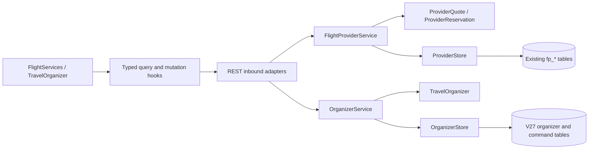

# ADR 0025 — Customer flight workflow and saved travel organizer

The user requested continued full-stack completion with mock integrations wherever a provider is required. Preserve the source scope and priorities; this increment does not declare every remaining requirement complete.

## Decisions

1. Connect the existing fictional airline API to a customer journey at `/flight-services`: seats, meals/baggage, immutable quotation, explicit acceptance, exclusive reservation, simulated payment, independent ticketing, passenger check-in, protected mock document download, cancellation/refund and persisted booking history. Keep existing flight booking intents unchanged. The fictional provider supports DEL–BOM economy at18:00IST only; this is not an add-on to any arbitrary legacy offer.
2. Reuse the generated OpenAPI client, TanStack Query and existing OIDC/CSRF security. No new library or backend service is needed. Stable keys derive from the persisted quote or reservation/version/action; browser refresh recovers state from owned resources. Account guards hide private content when identity/access changes. No optimistic payment or ticket success.
3. Add owned paginated provider history through `FlightProvider` / `ProviderStore`; foreign cursors fail404, pages contain at most20items. Reservation history ordering uses parsed instants and UUID tie-breaks, not lexical timestamp strings.
4. Add `TravelOrganizer` to the existing customer context. It owns at most20saved travellers,20category bookmarks,20flight search criteria and notification preference flags. It is actual PostgreSQL persistence, independent of supplier simulation mode. `CustomerOrganizer` and `OrganizerStore` preserve hexagonal boundaries.
5. Use consented, versioned full replacement for this small aggregate. Enforce expected customer identity, optimistic version, durable key/fingerprint receipts and atomic metadata audit. Same-key replay returns the original applied version and current saved fields, avoiding historical PII copies. Clearing arrays removes those reusable personal values; immutable booking/financial history is untouched. This is scoped data deletion/export, not whole-account erasure or a compliance claim.
6. Preserve unsubmitted flight search criteria in session storage using a strict allowlist. Never store names, birth dates, identity tokens or authoritative prices there. Submitted search results still restore canonical server criteria. Add mobile bottom navigation to keep discovery, seats, trips and account reachable.

## Dependencies and boundaries

V27 is additive. No customer history or prior migration is rewritten. Customer organizer receipts contain only fingerprint, applied version, correlation and time; no name/DOB snapshots. The provider context retains its already implemented immutable quote/payment/event history. New saved preferences do not magically deliver messages; notification consumers remain unfinished. Category bookmarks are not product-level wishlists or recently viewed history. Saved searches execute fresh discovery and do not subscribe to fare alerts.

## Acceptance and remaining work

AC-094: seat/extras quotation → accepted reservation → lost-response-safe payment → separate ticket → document → cancellation/refund/history.

AC-095: time-window and passenger-gated check-in → persisted state → explicitly invalid-for-travel document; no cancellation after check-in.

AC-096: owned saved travellers/searches/preferences → refresh → fresh search; atomic consent/version/replay/delete rules; unsubmitted draft survives category navigation; mobile and keyboard access.

[Verification](../verification-customer-workflows.md) records executed tests and their limits. [Remaining work](../requirements/remaining-work.md) retains outstanding P0/P1/P2 scope. Coupon redemption, full privacy, delivery workers, broad operations/reporting and other unmet source requirements are implementation work, not falsely labelled access blockers.
