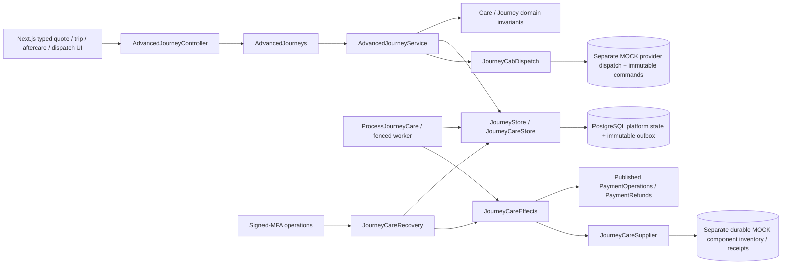
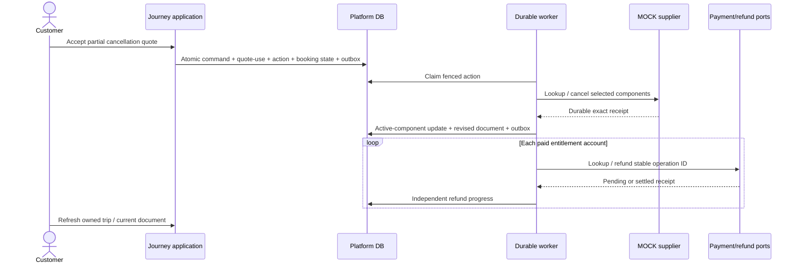
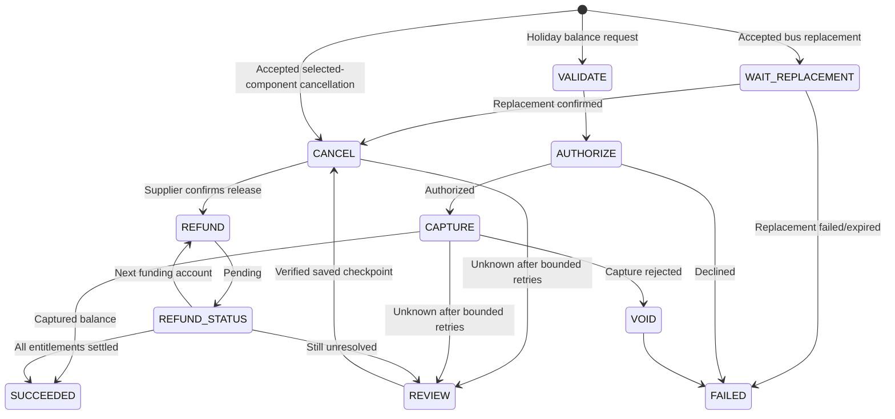

# Implemented journey enhancement boundaries

The existing modular journey context remains the owner. [Care](../apps/api/src/main/java/com/travbook/journeys/domain/model/Care.java) defines immutable terms, paid entitlements, action phases, funding summaries and forward-only dispatch states. [AdvancedJourneyService](../apps/api/src/main/java/com/travbook/journeys/application/usecase/AdvancedJourneyService.java) owns customer use cases; [JourneyCareWorker](../apps/api/src/main/java/com/travbook/journeys/application/usecase/JourneyCareWorker.java) coordinates durable work. Controllers validate transport, resolve principals and invoke inbound ports only.

Remote effect calls never run inside platform transactions. Provider simulators assert that boundary. Current state plus receipt/amount/currency/reference/owner checks guard recovery. Owner-bound foreign keys, unique active-action/component keys, optimistic versions, immutable quote-use/refund-entitlement records and lease tokens enforce concurrency and financial integrity. V23 is additive; quote/booking record shapes and supplier fingerprints from older versions are preserved.

Booking, initial payment, reservation, refund, care action, holiday balance and dispatch states remain separate. Initial capture is not proof of full funding; full funding is not proof of supplier confirmation. The UI exposes both and only serves a current document when their required conditions hold. The original booking is not cancelled merely because a replacement payment succeeded.
