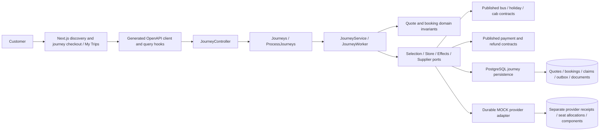
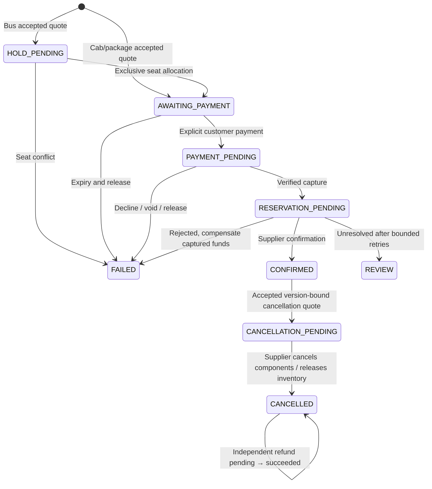

# Implemented journey lifecycle boundaries

[ADR 0019](adr/0019-journey-fulfilment.md), [API contracts](../contracts/openapi.json), [V21](../apps/api/src/main/resources/db/migration/V21__journey_fulfilment.sql), [operating limits](runbooks/journey-fulfilment.md).



Discovery remains independent of booking/payment internals. Bus discovery consumes its published `BusInventory` read capability, implemented by the provider adapter, to show current unavailable seats without exposing ownership. The composition root wires interfaces; there are no cross-context table reads in application/controller code. Existing payment adapters own their account/journal tables. ArchUnit verifies inward dependencies, published contracts and no context cycles.

```mermaid
sequenceDiagram
  actor C as Customer
  participant A as Journey application
  participant D as Platform PostgreSQL
  participant W as Fenced worker
  participant S as MOCK supplier
  participant P as MOCK payment service
  C->>A: Request fresh terms, accept quote, save passengers
  A->>D: Atomic command + immutable quote/acceptance + booking + work + event
  W->>D: Claim with lease token
  W->>S: Bus: hold seats (stable operation ID)
  S-->>W: Durable allocation receipt
  W->>D: Awaiting payment + outbox, release lease
  C->>A: Explicit payment command
  A->>D: Persist validation/payment work
  W->>S: Validate held bus allocation or revalidate cab/package terms
  W->>P: Lookup / authorize / capture
  W->>S: Lookup / reserve and confirm
  alt Confirmed supplier receipt
    W->>D: Confirmed state + immutable MOCK document + outbox
  else Known rejection after capture
    W->>P: Idempotent compensation refund
    W->>D: Failed booking; separate pending/succeeded refund
  else Unknown response
    W->>D: Backoff / lease expiry / retained checkpoint
    W->>S: Lookup original operation before retry
  end
```

Booking status, payment state, reservation state, refund state and workflow step are independent persisted fields. REVIEW preserves the unresolved step and never implies a failed or successful external operation. Local command commits and provider effect commits are separate; their stable receipts bridge a crash between them.



Database ownership: `journey_quote`, `journey_acceptance`, `journey_booking`, `journey_command`, `journey_work`, `journey_cancellation_quote`, `journey_document`, `journey_outbox`; provider-owned `journey_supplier_reservation`, `journey_supplier_seat`, `journey_supplier_component`, `journey_supplier_receipt`. One booking per quote, ownership foreign keys, unique seat keys, optimistic versions and fenced claims enforce correctness. Immutable records reject UPDATE/DELETE. Outbox consumers/broker delivery and notifications remain unimplemented for this context.

All six AWS pillars remain tied to evidence rather than deployment claims:

| Pillar | Increment control / verification | Remaining release work |
| --- | --- | --- |
| Operational excellence | Reproducible existing Compose images, worker metrics, correlation/outbox, recovery runbook, API/browser checks | Hosted pipeline execution, dashboards, operator REVIEW resolution |
| Security | OIDC ownership/scopes, CSRF, login allowlist, private document integrity, no event PII | Authorized IdP/MFA provisioning, production secret/retention controls, security assessment |
| Reliability | PostgreSQL claims/receipts, exclusive bus allocation, compensation, crash/duplicate tests, additive migration preservation | Production Multi-AZ, restore/DR drill, real supplier recovery contracts |
| Performance | Bounded existing discovery, bounded polling/retries, claim/owner indexes, short transactions | Load/soak and independent latency measurements |
| Cost | Existing modular deployment reused; no new paid resources or brokers | Cloud budgets/tags and measured cost per booking/search |
| Sustainability | No new service deployment, finite polling/work, no redundant provider retries after known receipt | Measured compute/storage efficiency and lifecycle retention |
