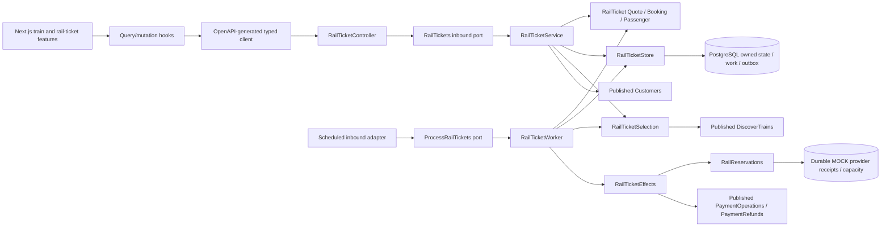
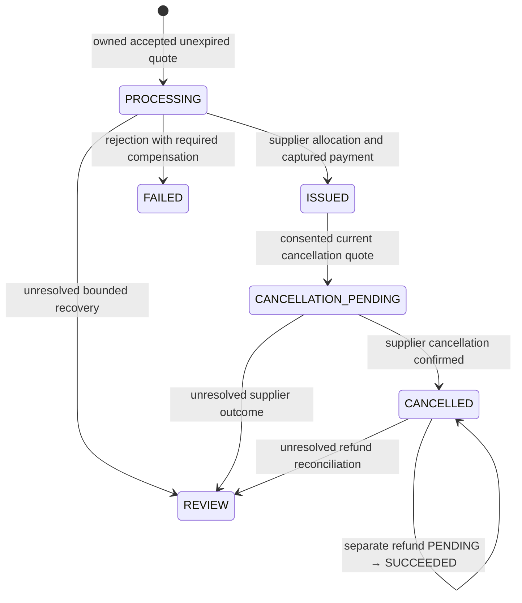
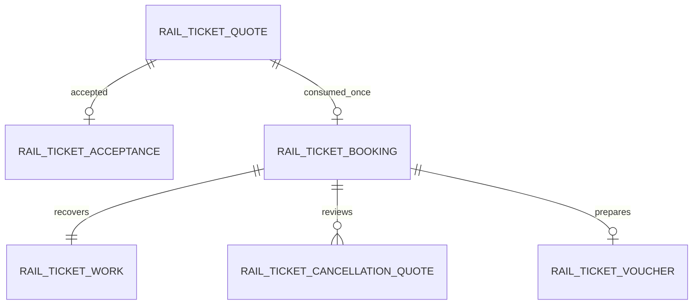
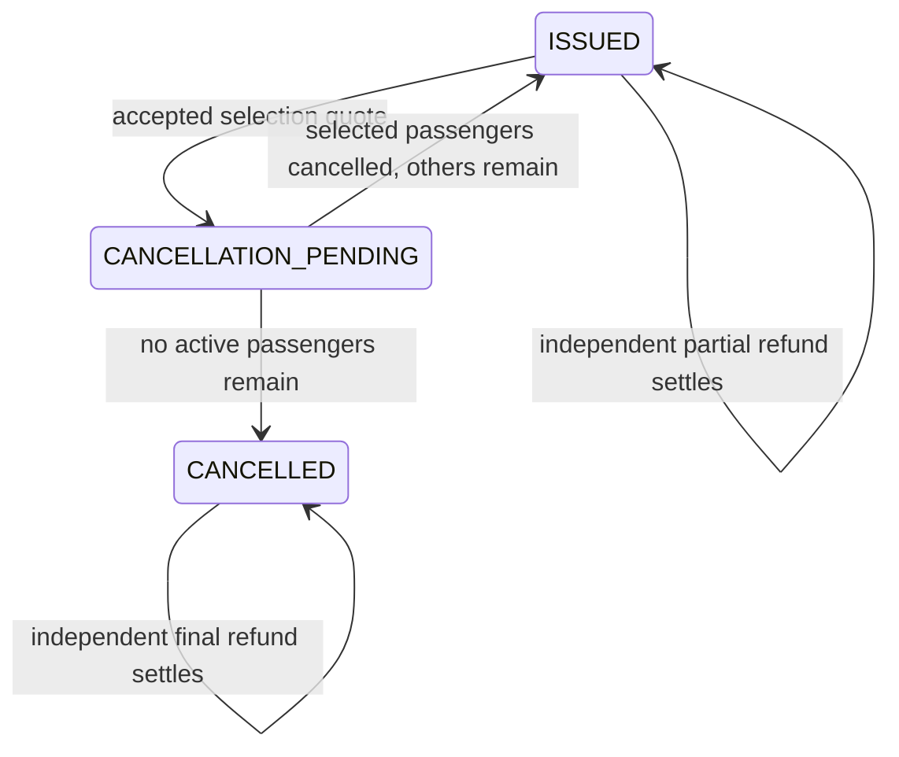
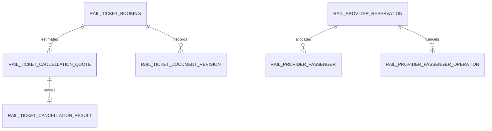

# Implemented rail lifecycle boundaries

This records the implemented MOCK extension to the supplied architecture baseline;
it does not describe AWS resources as provisioned. See [ADR0012](adr/0012-owned-rail-lifecycle.md).





ISSUED is a booking outcome, not a confirmed berth. Reservation is independently
NOT_STARTED → CONFIRMED/RAC/WAITLIST/REJECTED → CANCELLED. Payment independently moves
NOT_STARTED → AUTHORIZED → CAPTURED, or DECLINED/VOIDED. Refund separately NONE/PENDING/
SUCCEEDED/NOT_DUE. Work independently READY/RUNNING/DONE/REVIEW. Booking versions, lease
fences, command uniqueness and immutable provider receipts coordinate these states.

```mermaid
sequenceDiagram
  participant U as Owned UI
  participant A as RailTickets
  participant D as PostgreSQL
  participant W as Durable worker
  participant S as MOCK rail provider
  participant P as MOCK payment port
  U->>A: Passenger selection, quotation, acceptance
  A->>D: Immutable quote/consent + command/outbox
  U->>A: Booking + consent + idempotency key
  A->>D: One booking per quote + work + outbox (atomic)
  A-->>U: 202 saved PROCESSING
  W->>D: Claim with lease/fence
  W->>S: Revalidate current terms
  W->>P: Lookup then authorize stable operation
  W->>D: Save verified state/work/outbox
  W->>S: Lookup then reserve stable operation
  S->>S: Atomic capacity and immutable receipt
  Note over W,S: Lost response is unknown; next claim looks up receipt
  W->>P: Lookup then capture stable operation
  W->>D: ISSUED + independent ticket state + outbox
  U->>A: Poll bounded status / prepare protected summary
  U->>A: Cancellation quote then consent
  W->>S: Lookup then cancel
  W->>P: Submit/refetch bounded refund entitlement
  W->>D: CANCELLED with separate refund state
```

Persistence ownership: rail_ticket_* belongs to platform rail lifecycle;
rail_provider_* belongs to the deterministic supplier simulator; payment_* is accessed
only through published payment contracts. No cross-context table reads by rail code.
All effective calls occur outside platform database transactions. Outbox envelopes contain
state only, never passenger names/DOB. External event transport and audited REVIEW resolution
are still unimplemented; no exactly-once delivery claim is made.



These relationships are enforced by V14 primary/foreign/unique keys. Quote/booking JSON
snapshots preserve the entire immutable passenger party. Commands are uniquely scoped to
owner/operation/key; outbox aggregate IDs are polymorphic quote/booking/document references.
Provider operation receipts and allocations use their own atomic simulator transactions.
The current aggregate cancels the complete party; partial passenger fulfilment/cancellation
requires a later item-level model and provider contract, not an unverified boolean flag.

## Passenger-aware aftercare

V16 adds original-index passenger allocations and immutable per-cancellation results. The
accepted cancellation quote owns the selection and defines stable supplier/refund IDs.
Completed results remain append-only when another selection is cancelled. V2 detail reads
hold the booking lock while reading refund history, avoiding mixed-version projections.





The persisted null/non-null cancellation scope discriminates the existing whole-party policy
from the optional MOCK-RAIL-PARTIAL-V1 policy. Future policy changes require a new persisted
discriminator and compatible contract; the existing terms/entitlements must not be reinterpreted.
Legacy JSON defaults are explicit adapter mappings, not relaxed HTTP validation. Current
MOCK documents remain invalid for real travel and obsolete revisions are blocked.
