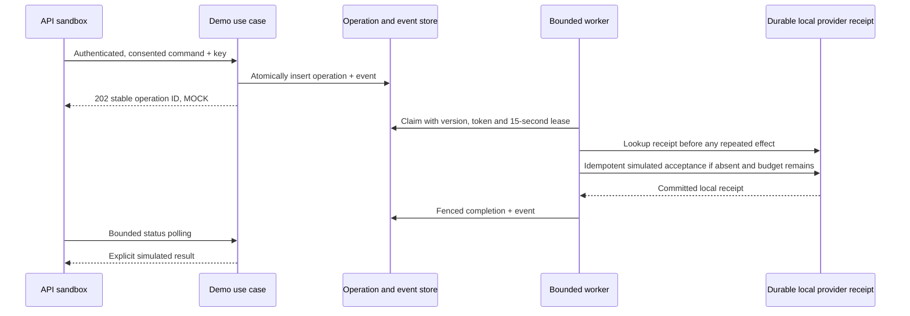

# Local dummy API services

The requested dummy APIs run inside the existing modular Java backend. They use real HTTP, verified local OIDC, PostgreSQL persistence and the normal typed frontend client, while their external-provider outcomes are explicitly **MOCK**. They do not require supplier, gateway, messaging, GPS or AWS credentials.

Start the local [Compose stack](../../compose.yaml), sign in at `/account`, then open **API sandbox** at `/sandbox`. The supplied local fixture users are documented in the existing identity guide. Do not use their credentials outside local testing.

```sh
docker compose up -d --build --wait --wait-timeout 180
```

Compose enables `DEMO_APIS_ENABLED=true`. The application default outside Compose is false; manual local development and CI must explicitly set the flag. Dummy APIs also require `INTEGRATION_MODE=MOCK`. `DEMO_WORKER_ENABLED=false` pauses queued processing without deleting work. Worker polling defaults to 1,000 ms with at most ten claims per scheduler pass. Stop/restart preserves operations, receipts and history.

## Endpoint catalog

All new endpoints require verified authentication. Cookie POSTs require the current CSRF token from `/auth/session`. Use the generated client or OpenAPI for exact schemas, examples, headers and errors.

| Method / path | Behavior and boundary |
| --- | --- |
| GET `/api/v1/demo/catalog` | Links to implemented travel and booking-payment APIs; not a supplier health assertion. |
| POST `/api/v1/demo/operations` | Owned EMAIL, SMS, PRIVACY_EXPORT or PRIVACY_ERASURE simulation. Explicit consent and expected customer guard; durable idempotency. Returns 202, not completed delivery. |
| GET `/api/v1/demo/operations` | Cursor-paginated own history, 20 items, no cross-owner cursor access. |
| GET `/api/v1/demo/operations/{id}` | Durable current status, attempts, reference and terminal polling indicator. |
| POST `/api/v1/demo/coupons/preview` | `DEMO10`: 10%, minimum INR1,000, cap INR500. `DEMOEXPIRED` demonstrates expiry; other codes are rejected. Uses an owned unexpired **flight** quote; never changes/redempts the original quote or payment. Requires `quotes:read`. |
| GET `/api/v1/demo/gps/{id}` | Owned cab booking's persisted dispatch stage mapped to synthetic coordinates, with freshness and terminal state. Requires `bookings:read`. |
| GET `/api/v1/demo/payments/{id}` | Read an owned existing payment account; requires `bookings:read`. No arbitrary amount or charge API. |
| GET `/api/v1/demo/financial-report` | Exact owner-scoped MOCK account/journal/refund totals and integrity counts in one bounded database snapshot. Requires `bookings:read`. Not external settlement or global operator reporting. |
| GET `/api/v1/demo/privacy-preview` | Actual current profile fields only, with an explicit list of excluded account categories. Not a full account export. |
| GET `/api/v1/demo/deployment` | Dummy target descriptor `LOCAL_COMPOSE` / `NOT_DEPLOYED`; it neither provisions nor discovers real AWS infrastructure. |

The sandbox returns customer context on private results so the frontend can discard data if the active login changes. The caller cannot choose an owner. Foreign resources return 404; writes with an unexpected customer return 409. API scope checks are retained when the sandbox reads quotes, bookings or financial records. There is no privileged-user bypass.

### Dummy request example

After obtaining your customer ID from `/api/v1/me`, send this body with a new `Idempotency-Key` and your authenticated session/CSRF headers:

```json
{
  "expectedCustomerId": "YOUR_CUSTOMER_UUID",
  "kind": "EMAIL",
  "scenario": "RETRY_ONCE",
  "consent": true
}
```

Use `NORMAL`, `RETRY_ONCE` or `FAIL`. The key accepts 16–128 letters/digits or `._:-`. Retry the same body/key if acknowledgement is lost. Changed-body key reuse conflicts. Accepted operations can be found in owned history after browser refresh. No arbitrary recipient address or free-text message is accepted; unknown input fields are rejected. No email/SMS provider is contacted.

## Processing and recovery



Three provider attempts maximum; transient delays are two/four seconds. Claims persist attempts before provider work. If the third claim expires, recovery only checks for an existing receipt before concluding failure; it does not perform a fourth effect. A lost acknowledgement after provider commit is recovered using the same operation ID and owner/kind/scenario fingerprint. No provider call holds the orchestration transaction open. Local provider transactions have a three-second timeout. Events and input history are immutable.

Message terminal success is `SIMULATED_DELIVERED`, meaning a **local receipt only**. Privacy success is `SIMULATED_REVIEW_REQUIRED`, meaning **no erasure or complete export**. `terminal` only stops simulator polling. `FAIL` ends as FAILED with no success reference after three attempts. Infrastructure failures leave a recoverable leased operation rather than manufacturing success. `travbook.demo.worker.errors` counts worker infrastructure errors without logging contact details.

If a receipt remains unreadable or its binding cannot be trusted after the third attempt, processing terminates in SIMULATED_REVIEW_REQUIRED with no success reference once local persistence is available. Provider lookups and writes both have their own three-second transaction budgets. Review is not delivery success; no customer endpoint forces a final outcome. Only explicitly listed HTTP methods/routes are authorized, so HEAD/POST cannot bypass a GET-only financial scope check.

The UI polls a selected operation at bounded 3–10 second intervals, stops on errors/terminal state or after 30 updates, and provides manual refresh. GPS polls at ten seconds, at most 30 updates, with background polling disabled. The existing owned `/api/v2/journey-bookings/{id}/dispatch-demo` command advances synthetic stages; unavailable/cancelled positions are null. Coordinates do not describe the vehicle's real route. Stale dispatch timestamps are never replaced with a false fresh observation time.

## Existing travel and payment behavior

Flights, trains, buses, hotels, holidays and cabs retain their existing search → owned quote → booking → MOCK payment → confirmation → supported aftercare APIs. The new catalog points to those workflows, rather than exposing unsafe arbitrary charge/reservation mutations. Cab journey payment-account IDs equal their booking IDs; other workflows may use separate payment IDs. Read them from the corresponding workflow records, not by guessing another customer's ID.

The financial summary reads actual stored MOCK journals and accounts, not fixed sample totals. Captured/refunded values come from journal postings; pending refunds and authorizations are independent. Net captured is captured minus completed refunds. Integrity checks cover missing/unbalanced/exact-amount postings, refund-owner/currency binding and over-committed refunds. They are not a complete accounting audit, approved financial export, bank settlement reconciliation or money balance. The read has a three-second transaction budget and an owner/status index; production capacity remains unmeasured.

## Migration / deployment

V25 adds `demo_operation`, `demo_event`, a separate provider fixture `demo_delivery_receipt`, and a payment-report index. It does not rewrite accepted booking terms, profile data or existing financial entries. Back up retained data before rollout; never reset the data volume. Disable the feature to hide the dummy APIs; optionally pause the worker while preserving pending records. Rollback should leave these additive tables intact.

The AWS stand-in is the existing [mocked Terraform test suite](../../infra/aws/tests/security.tftest.hcl), not a fake deployment service:

```sh
terraform -chdir=infra/aws fmt -check -recursive
terraform -chdir=infra/aws validate
terraform -chdir=infra/aws test
```

No `plan` against an account or `apply` is performed. Live integrations and cloud deployment still require approved provider contracts/access and a real target.

## Completion boundary

These requested dummy APIs do **not** complete production notification templates/preferences/triggers, coupon redemption and discounted checkout, full privacy export/deletion and retention, live GPS, externally valid tickets, hosted payments/webhooks, settlement reconciliation or AWS deployment. The RTM keeps those source requirements open. [Verification evidence](../verification-local-api-sandbox.md) distinguishes executed simulator tests from unavailable production evidence.
